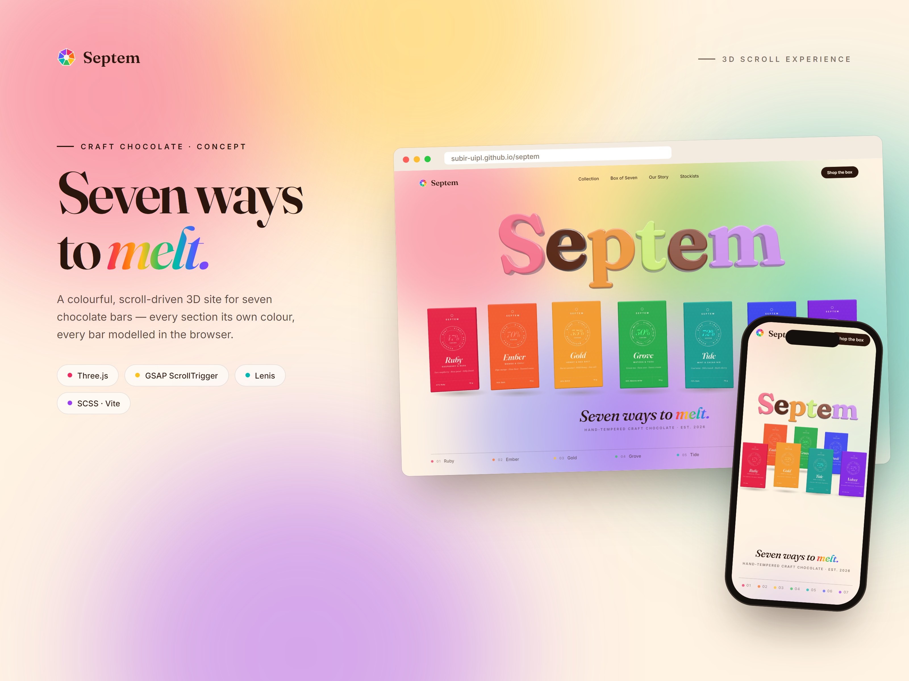
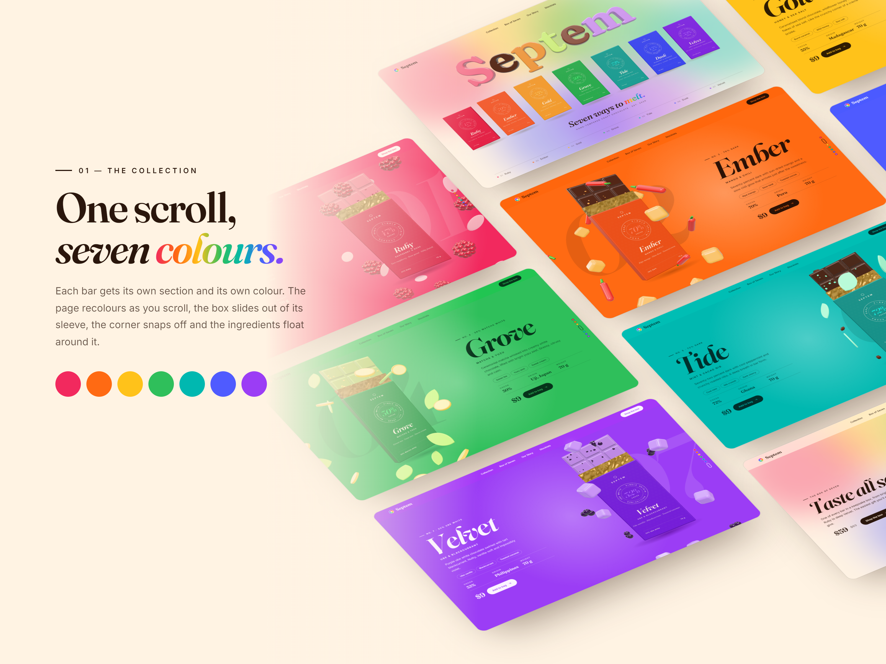
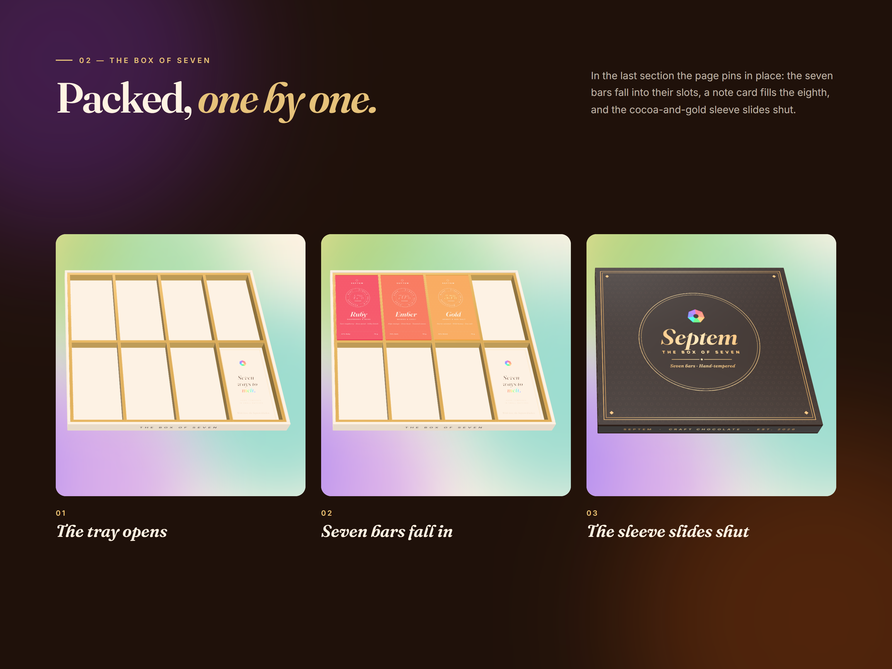
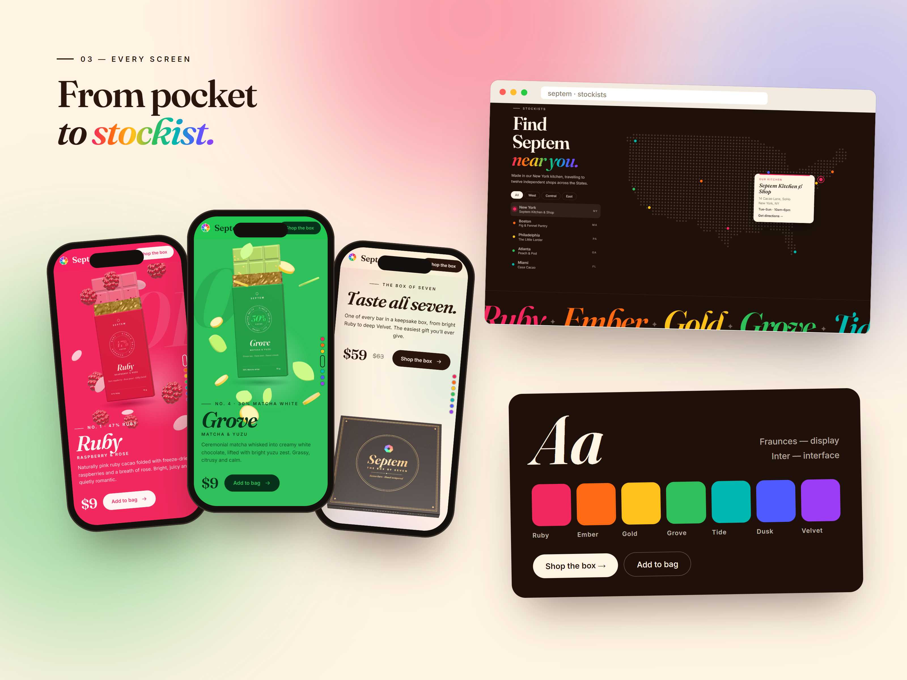

# Septem — Seven ways to melt.

A colourful, scroll-driven 3D website for **Septem**, a concept craft-chocolate brand with seven bars. Every bar has its own section and its own colour, and everything you see in 3D — the bars, their boxes, the ingredients and the gift box — is modelled, lit and animated in the browser with Three.js.

<p align="center">
  <a href="https://subir-uipl.github.io/septem/"></a>
</p>

<p align="center">
  <strong><a href="https://subir-uipl.github.io/septem/">▶ Open the live site</a></strong> · scroll all the way down, then hover the gift box
</p>

[](https://subir-uipl.github.io/septem/)

## Highlights

- **3D chocolate wordmark.** "Septem" is built from the real Fraunces glyph outlines, extruded into glossy letters, each cast in a different chocolate. The letters lean towards the pointer.
- **Seven bars on a shelf.** Hover a box and its chocolate slides out with a name tag; click to jump to that bar.
- **One section per flavour.** The page recolours as you scroll. The bar arrives, its chocolate slides out of the box, the corner snaps off and the bar's ingredients — raspberries, chillies, honeycomb, yuzu and more — float around it.
- **The Box of Seven.** The final section pins in place while the seven bars fall into a gift box one by one, a note card fills the eighth slot, and a cocoa-and-gold sleeve slides shut. Hover the closed box for a peek inside.
- **Store locator.** A dot-matrix map of the US with twelve stockists, region filters and a store card.
- **Responsive.** On phones the bars, the box and the copy restack to fit.

## Screenshots

| | |
|---|---|
|  |  |
|  | |

## Built with

- [Three.js](https://threejs.org/) — scene, models and materials
- [GSAP](https://gsap.com/) + ScrollTrigger — one scrubbed timeline drives the whole page
- [Lenis](https://lenis.darkroom.engineering/) — smooth scrolling
- [opentype.js](https://opentype.js.org/) — turns the Fraunces font into 3D letter shapes
- SCSS and [Vite](https://vitejs.dev/)
- Fonts: [Fraunces](https://fonts.google.com/specimen/Fraunces) and [Inter](https://fonts.google.com/specimen/Inter)

## Run locally

Requires Node.js 18 or newer.

```bash
npm install
npm run dev
```

Then open the address it prints, usually `http://localhost:5173`.

| Command | What it does |
|---|---|
| `npm run dev` | Development server with live reload |
| `npm run build` | Production build into `dist/` |
| `npm run preview` | Serve the production build locally |

## Project structure

```
septem/
├── index.html                 Page markup
├── public/favicon.svg
├── src/
│   ├── main.js                Sets everything up and runs the render loop
│   ├── data/
│   │   ├── products.js        The seven bars: names, colours, copy, ingredients
│   │   └── stores.js          Stockists for the locator
│   ├── scene/
│   │   ├── stage.js           Renderer, camera and lights
│   │   ├── bar.js             Chocolate bar and its box
│   │   ├── label.js           Printed box artwork (drawn on canvas)
│   │   ├── letters.js         3D chocolate wordmark
│   │   ├── ingredients.js     Floating ingredients for each flavour
│   │   ├── giftbox.js         The Box of Seven: tray, note card and sleeve
│   │   └── floorShadow.js     Soft contact shadows
│   ├── scroll/timeline.js     All scroll choreography and layouts
│   ├── ui/
│   │   ├── dom.js             Sections, reveals, nav and toast
│   │   └── locator.js         US dot-matrix map and store list
│   ├── styles/                SCSS partials
│   └── utils/rng.js
├── screenshots/               Presentation images
└── .github/workflows/deploy.yml
```

Most content lives in `src/data/`: change a flavour's name, colour or copy in `products.js` and both its section and its 3D box update.

## Performance

- Three.js, the animation libraries and the font parser ship as separate cached chunks; the app code itself is about 16 KB gzipped.
- Each bar's chocolate is a single merged mesh, which keeps draw calls low with all seven bars on screen.
- The 3D layer stops rendering once the footer covers the screen, and the blurred background glows are switched off while they're invisible.
- Smooth scrolling and motion are turned off for visitors who prefer reduced motion.

## Deploy

The site is live on GitHub Pages at **<https://subir-uipl.github.io/septem/>**.

It deploys automatically with GitHub Actions on every push to `main` (see `.github/workflows/deploy.yml`). One-time setup in your repo: **Settings → Pages → Build and deployment → Source: GitHub Actions**.

## Credits

Septem is a fictional brand. The products, prices, stockists and addresses are placeholder content for this concept.
